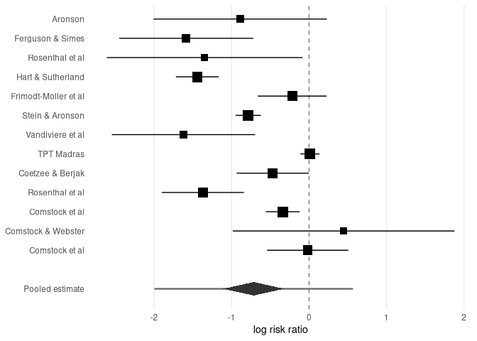

<!-- README.md is generated from README.Rmd. Please edit that file. -->

# tidysynthesis

<!-- badges: start -->

[](https://github.com/jmozez/tidysynthesis/actions/workflows/R-CMD-check.yaml)
[](https://github.com/jmozez/tidysynthesis/actions/workflows/lint.yaml)
<!-- badges: end -->

tidysynthesis brings meta-analysis and evidence synthesis into the
tidyverse and tidymodels. Effect sizes, pooled models, meta-regressions,
network meta-analyses and bias diagnostics are all tibbles, so they can
be filtered, joined and plotted with the tools you already use, and
every function takes the data as its first argument so it works with the
pipe.

The estimators are written in base R and are checked against
[metafor](https://www.metafor-project.org) in the test suite.

## Installation

Install the development version from GitHub with:

``` r
# install.packages("pak")
pak::pak("jmozez/tidysynthesis")
```

## What it does

| Area | Functions |
|----|----|
| Effect sizes | `meta_effect_size()` for SMD (Hedges' g), MD, log RR, log OR, log IRR, Fisher's z and logit proportions; `meta_transform()` |
| Pooling | `meta_pool()` with FE, REML, ML, DL, PM and SJ estimators, Hartung-Knapp-Sidik-Jonkman tests and prediction intervals |
| Moderators | `meta_regress()`, `meta_subgroup()` and `meta_multilevel()` (three-level and phylogenetic models) |
| Networks | `meta_pairwise()` and `meta_network()` with league tables, P-scores, design-by-treatment inconsistency and direct and indirect evidence |
| Small-study effects | `meta_egger()`, `meta_begg()`, `meta_trimfill()`, `meta_pet_peese()` and `meta_failsafe()` |
| Sensitivity | `meta_leave1out()`, `meta_cumulative()` and `meta_influence()` |
| tidymodels | `step_meta_effect_size()`, `step_meta_precision()` and `step_meta_impute_sd()` for recipes; `meta_leave_study_out_cv()` and `meta_cluster_cv()` for rsample; `inverse_var_rmse()`, `coverage_prob()` and `heterogeneity_r2()` for yardstick; `meta_linear()` for parsnip |
| Output | `tidy()`, `glance()`, `augment()`, `predict()` and `autoplot()` methods |

## A first meta-analysis

The `bcg_trials` data hold the 13 trials of the BCG vaccine against
tuberculosis summarised by Colditz et al. (1994).

``` r
library(tidysynthesis)

bcg <- meta_effect_size(
  bcg_trials, "RR",
  event1 = tpos, n1 = tpos + tneg,
  event2 = cpos, n2 = cpos + cneg,
  study = author
)

fit <- meta_pool(bcg, method = "REML", test = "hksj")
fit
#> # Meta-analysis <meta_fit>
#> # Model: random effects, restricted maximum likelihood
#> # Measure: log risk ratio; k = 13
#> # tau^2 = 0.3132; I^2 = 92.22%; H^2 = 12.86
#> # Q(12) = 152.23, p < 0.0001
#> # 95% prediction interval: [-1.9960, 0.5670]
#> # Inference: Hartung-Knapp-Sidik-Jonkman t tests (df = 12)
#> # A tibble: 1 x 7
#>   term    estimate std.error statistic  p.value conf.low conf.high
#>   <chr>      <dbl>     <dbl>     <dbl>    <dbl>    <dbl>     <dbl>
#> 1 overall  -0.7145    0.1808    -3.952 0.001920   -1.108   -0.3206
glance(fit)
#> # A tibble: 1 x 21
#>   model_type  nobs method test    tau2 tau2.low tau2.high    tau    I2    H2
#>   <chr>      <int> <chr>  <chr>  <dbl>    <dbl>     <dbl>  <dbl> <dbl> <dbl>
#> 1 pool          13 REML   hksj  0.3132   0.1197     1.111 0.5597 92.22 12.86
#> # i 11 more variables: R2 <dbl>, QE <dbl>, df.residual <int>, p.QE <dbl>,
#> #   QM <dbl>, p.QM <dbl>, pred.low <dbl>, pred.high <dbl>, logLik <dbl>,
#> #   AIC <dbl>, BIC <dbl>
```

Absolute latitude explains much of the heterogeneity:

``` r
meta_regress(bcg, ~ ablat) |> glance()
#> # A tibble: 1 x 21
#>   model_type  nobs method test     tau2 tau2.low tau2.high    tau    I2    H2
#>   <chr>      <int> <chr>  <chr>   <dbl>    <dbl>     <dbl>  <dbl> <dbl> <dbl>
#> 1 regression    13 REML   z     0.07635  0.01668    0.7848 0.2763 68.39 3.164
#> # i 11 more variables: R2 <dbl>, QE <dbl>, df.residual <int>, p.QE <dbl>,
#> #   QM <dbl>, p.QM <dbl>, pred.low <dbl>, pred.high <dbl>, logLik <dbl>,
#> #   AIC <dbl>, BIC <dbl>
```

Small-study effects and sensitivity checks take the same data or the
fitted model:

``` r
meta_egger(fit)
#> # A tibble: 1 x 11
#>   test  predictor model estimate std.error statistic    df p.value
#>   <chr> <chr>     <chr>    <dbl>     <dbl>     <dbl> <int>   <dbl>
#> 1 Egger sei       lm      -2.112     1.507    -1.401    11  0.1887
#> # i 3 more variables: limit_estimate <dbl>, limit_conf.low <dbl>,
#> #   limit_conf.high <dbl>
meta_trimfill(fit)
#> # Trim-and-fill adjusted meta-analysis <meta_fit>
#> # Model: random effects, restricted maximum likelihood
#> # Measure: log risk ratio; k = 14
#> # tau^2 = 0.3313; I^2 = 92.14%; H^2 = 12.72
#> # Q(13) = 154.68, p < 0.0001
#> # Studies filled on the right side: 1
#> # 95% prediction interval: [-1.9609, 0.6467]
#> # Inference: Hartung-Knapp-Sidik-Jonkman t tests (df = 13)
#> # A tibble: 1 x 7
#>   term    estimate std.error statistic  p.value conf.low conf.high
#>   <chr>      <dbl>     <dbl>     <dbl>    <dbl>    <dbl>     <dbl>
#> 1 overall  -0.6571    0.1815    -3.620 0.003110   -1.049   -0.2650
meta_leave1out(fit)
#> # A tibble: 13 x 12
#>    study   estimate std.error statistic  p.value conf.low conf.high   tau2    I2
#>    <chr>      <dbl>     <dbl>     <dbl>    <dbl>    <dbl>     <dbl>  <dbl> <dbl>
#>  1 Aronson  -0.7071    0.1940    -3.645 0.003856   -1.134   -0.2801 0.3362 93.23
#>  2 Fergus~  -0.6540    0.1814    -3.606 0.004129   -1.053   -0.2548 0.2926 92.25
#>  3 Rosent~  -0.6856    0.1887    -3.633 0.003935   -1.101   -0.2702 0.3207 92.94
#>  4 Hart &~  -0.6284    0.1819    -3.454 0.005390   -1.029   -0.2280 0.2628 90.41
#>  5 Frimod~  -0.7642    0.1919    -3.981 0.002154   -1.187   -0.3417 0.3278 92.76
#>  6 Stein ~  -0.7109    0.1997    -3.559 0.004482   -1.151   -0.2712 0.3596 90.91
#>  7 Vandiv~  -0.6552    0.1808    -3.624 0.003997   -1.053   -0.2573 0.2930 92.28
#>  8 TPT Ma~  -0.7948    0.1823    -4.360 0.001137   -1.196   -0.3935 0.2732 87.03
#>  9 Coetze~  -0.7412    0.1969    -3.764 0.003133   -1.175   -0.3078 0.3495 93.21
#> 10 Rosent~  -0.6530    0.1867    -3.498 0.004988   -1.064   -0.2421 0.2987 92.23
#> 11 Comsto~  -0.7579    0.1955    -3.877 0.002576   -1.188   -0.3276 0.3405 91.81
#> 12 Comsto~  -0.7598    0.1789    -4.247 0.001372   -1.154   -0.3661 0.3082 92.68
#> 13 Comsto~  -0.7775    0.1855    -4.191 0.001509   -1.186   -0.3692 0.3037 92.34
#> # i 3 more variables: H2 <dbl>, QE <dbl>, p.QE <dbl>
```

``` r
autoplot(fit, type = "forest")
```



## Network meta-analysis

``` r
pw <- meta_pairwise(smoking_cessation, study = study, treatment = trt,
                    measure = "OR", event = xi, n = ni)
nma <- meta_network(pw, study = study, treat1 = treat1, treat2 = treat2,
                    reference = "no_contact", small_values = "bad")
nma
#> # Network meta-analysis <meta_nma>
#> # Model: random effects, restricted maximum likelihood; reference: no_contact
#> # Measure: log odds ratio; 24 studies, 4 treatments, 8 designs
#> # tau^2 = 0.4502; Q(23) = 202.62, p < 0.0001
#> # Inconsistency between designs: Q(7) = 15.22, p = 0.0333
#> # A tibble: 4 x 6
#>   treatment      estimate std.error conf.low conf.high  pscore
#>   <chr>             <dbl>     <dbl>    <dbl>     <dbl>   <dbl>
#> 1 no_contact       0        NA       NA         NA     0.04111
#> 2 grp_counseling   0.8687    0.3721   0.1395     1.598 0.8474 
#> 3 ind_counseling   0.7090    0.1953   0.3263     1.092 0.7155 
#> 4 self_help        0.3972    0.3286  -0.2470     1.041 0.3960
tidy(nma, type = "inconsistency")
#> # A tibble: 3 x 4
#>   source               Q    df   p.value
#>   <chr>            <dbl> <int>     <dbl>
#> 1 total           202.6     23 1.078e-30
#> 2 within designs  187.4     16 2.754e-31
#> 3 between designs  15.22     7 3.328e- 2
```

## tidymodels

Effect sizes can be computed inside a recipe, models can be tuned with
study-level resampling and scored with inverse variance metrics:

``` r
library(parsnip)

folds <- meta_leave_study_out_cv(bcg, study = author)
folds
#> #  Leave-one-study-out cross-validation
#> # A tibble: 11 x 2
#>    splits         id                  
#>    <list>         <chr>               
#>  1 <split [12/1]> Aronson             
#>  2 <split [12/1]> Ferguson & Simes    
#>  3 <split [11/2]> Rosenthal et al     
#>  4 <split [12/1]> Hart & Sutherland   
#>  5 <split [12/1]> Frimodt-Moller et al
#>  6 <split [12/1]> Stein & Aronson     
#>  7 <split [12/1]> Vandiviere et al    
#>  8 <split [12/1]> TPT Madras          
#>  9 <split [12/1]> Coetzee & Berjak    
#> 10 <split [11/2]> Comstock et al      
#> 11 <split [12/1]> Comstock & Webster

meta_linear(engine = "reml") |>
  fit(.yi ~ ablat, data = bcg) |>
  predict(new_data = data.frame(ablat = c(15, 45)), type = "pred_int")
#> # A tibble: 2 x 2
#>   .pred_lower .pred_upper
#>         <dbl>       <dbl>
#> 1     -0.8093      0.4392
#> 2     -1.670      -0.4464
```

## Data

| Dataset | Description | Source |
|----|----|----|
| `bcg_trials` | BCG vaccine trials | Colditz et al. (1994) |
| `stroke_los` | Length of hospital stay in stroke units | Normand (1999) |
| `adherence_cor` | Conscientiousness and medication adherence | Molloy et al. (2014) |
| `school_calendar` | Modified school calendars and achievement (three-level) | Konstantopoulos (2011) |
| `smoking_cessation` | Smoking cessation interventions (network) | Hasselblad (1998) |

See the help page of each dataset for the full citation.

## Companion advisor

[tidyvisor](https://github.com/jmozez/tidyvisor) is an optional
companion advisor for tidysynthesis. It is not required to use this
package.

## Licence

MIT (c) 2026 Jimmy Moses.
